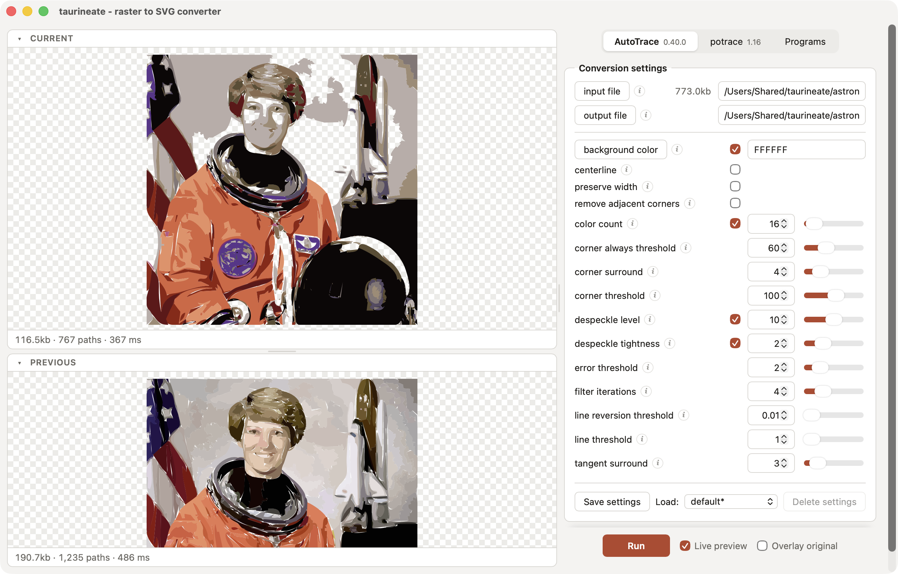
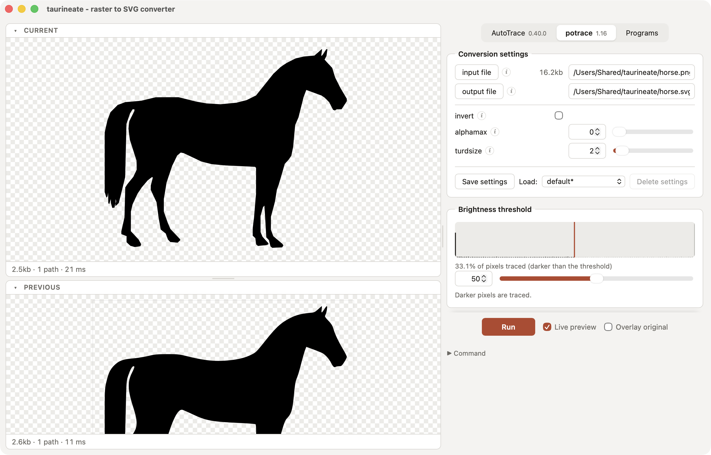

🐂 *taurineate* - a [Tauri](https://tauri.app) app in the spirit of [Delineate](http://delineate.sourceforge.net)

💧 Just launch `npm install && npm run tauri dev`

A native (macOS and Linux) prototype that converts raster images to SVG with [potrace](https://potrace.sourceforge.net) or [AutoTrace](https://github.com/autotrace/autotrace), keeping Delineate's workflow: engine tabs, a settings panel generated from each tracer's options, Current and Previous results side by side, and saved settings. The tracers stay separate programs that taurineate runs; nothing is linked in.

What's new compared with Delineate:
* Live preview: results update as you move a slider (Run still writes the output file).
* Synced zoom and pan on both results, plus an overlay of the original image.
* Any common image format (PNG, JPEG, GIF, BMP, TIFF, WebP, PNM), and drag-and-drop.
* Settings and presets are stored in the app config directory, not `./settings`.

## Requirements

* Rust (via [rustup](https://rustup.rs)) and Node.js 20+
* potrace and AutoTrace
  * macOS: `brew install potrace autotrace`
  * Debian/Ubuntu: `sudo apt install potrace autotrace` plus Tauri's [Linux prerequisites](https://tauri.app/start/prerequisites/#linux) (`libwebkit2gtk-4.1-dev` and friends)

The **Programs** tab shows which program each tracer uses and where it was found; a ⚠ on that tab means a program is missing, and **Search again** picks up a newly installed program without restarting. taurineate searches, in order:

1. the program you chose with **Choose…** (like Delineate's first-run prompt; **Use automatic** clears it)
2. the `TAURINEATE_POTRACE` / `TAURINEATE_AUTOTRACE` environment variable, e.g. `TAURINEATE_POTRACE=$HOME/src/potrace/potrace`
3. `PATH`
4. the usual install folders: Homebrew (`/opt/homebrew/bin`, `/usr/local/bin`, Linuxbrew), MacPorts, `/usr/bin`, Nix, `/snap/bin`, `~/.local/bin`, `~/bin`
5. your login shell's `PATH`, read once and only when nothing else matched (apps opened from Finder or a desktop launcher don't get it)

A candidate is used only if `--version` runs and names the right program. A chosen path or variable that stops working is skipped with a warning.

## Commands

* `npm run tauri dev`: run in development mode
* `npm run tauri build`: build the app bundle (`.app`/`.dmg` on macOS, AppImage/`.deb` on Linux)
* `cd src-tauri && cargo test`: Rust unit tests; the end-to-end trace test runs the installed potrace and autotrace, and skips any that are missing

## How it works

* `src-tauri/tracers/*.json` describe each tracer's options (ported from Delineate's `settings/parameters-*.xml`). The settings panel is generated from them, and `tracers.rs` turns the values into command-line flags. To support another option, add it to the JSON.
* `raster.rs` decodes the image. For potrace it applies the brightness threshold itself and pipes a PBM on stdin, as Delineate did; for AutoTrace it writes a temporary PPM.
* `trace.rs` runs one tracer at a time: starting a new trace kills the previous process, so live preview never queues stale work.
* The frontend is plain TypeScript (`src/`), with no framework.

## Next steps

* Delineate's SVG optimizers (group paths by color, one group, etc.)
* A longer result history than Current/Previous
* Bundling potrace and AutoTrace inside the app (Tauri sidecars), signing and notarizing for macOS, Flatpak

## License and credits

taurineate is free software, released under the GNU General Public License, version 2 or (at your option) any later version. See [LICENSE](LICENSE).

* [Delineate](http://delineate.sourceforge.net) © Rob McKinnon, GPLv2. taurineate's option descriptors (`src-tauri/tracers/*.json`) are ported from its `settings/parameters-*.xml`.
* [Potrace](https://potrace.sourceforge.net) © Peter Selinger, GPL v2 or later. "Potrace" is a trademark of Peter Selinger.
* [AutoTrace](https://github.com/autotrace/autotrace): the program is GPL v2 or later, the library LGPL v2.1 or later.

taurineate doesn't include potrace or AutoTrace; it runs them as separate programs.

The sample images in `docs/samples` come from [scikit-image](https://github.com/scikit-image/scikit-image)'s test data:

* `astronaut.png`: astronaut Eileen Collins, a NASA photo ([NASA Great Images](https://flic.kr/p/r9qvLn)), public domain
* `horse.png`: horse silhouette by Andreas Preuss (marauder), [openclipart](http://openclipart.org/detail/158377/horse-by-marauder), CC0
